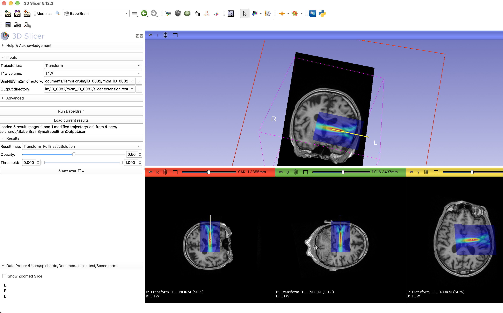

# SlicerBabelBrain

3D Slicer extension to run [BabelBrain](https://github.com/ProteusMRIgHIFU/BabelBrain)
transcranial focused ultrasound simulations for trajectories planned in 3D Slicer,
and to load the results back into the scene.



## Requirements

> [!IMPORTANT]
> This extension does **not** include the simulation engine. It requires a separate
> installation of **BabelBrain 0.8.8 or newer** (the first version supporting the JSON
> exchange protocol used by this extension). BabelBrain is free and open source (BSD-3).
>
> - Installers for macOS and Windows: <https://github.com/ProteusMRIgHIFU/BabelBrain/releases>
> - Documentation and installation from source (Linux): <https://proteusmrighifu.github.io/BabelBrain/>
>
> BabelBrain needs a supported GPU (CUDA, OpenCL, Metal or MLX) and
> [SimNIBS](https://simnibs.github.io/simnibs/) `charm` segmentation outputs (m2m directory)
> of the subject.

The extension talks to BabelBrain exactly as Brainsight 2.6 does: BabelBrain is started with
`-bInUseWithBrainsight` and the inputs/results are exchanged through JSON files in
`~/.BabelBrainSync`. No changes to BabelBrain are needed.

## Installation

1. Install BabelBrain (see [Requirements](#requirements)).
2. In 3D Slicer, open the *Extensions Manager*, search for **BabelBrain**, install it and
   restart Slicer.
3. The module appears under *Modules → Focused Ultrasound → BabelBrain*.

### For developers (from source)

1. Clone this repository.
2. In Slicer: *Edit → Application Settings → Modules → Additional module paths*, add
   `<this repository>/BabelBrain`, and restart Slicer.
   (Alternatively, drag and drop the `BabelBrain` folder onto the Slicer window and
   choose *Add Python scripted modules to the application*.)

## Usage

A *trajectory* is a linear transform: its translation is the target and its 3rd axis
is the direction of the trajectory (pointing towards the head, as in SlicerIGT, the
same convention BabelBrain uses for 3D Slicer trajectory files).

Required inputs (the **Run BabelBrain** button stays disabled until all are set; its
tooltip and the status line list what is missing):

| Input | Notes |
|---|---|
| Trajectories | One or more linear transforms (check them in the list). Names are sanitized (letters, digits, `.`, `_`, `-`) and made unique, as BabelBrain uses them in file names. |
| T1w volume | The volume used for planning, already loaded in Slicer. If it was not loaded from a NIfTI-1 file (or was modified), it is exported to the output directory. It must not be under a transform. |
| SimNIBS m2m directory | Selected with a folder dialog. |
| Output directory | Selected with a folder dialog; BabelBrain writes all its results there. |

**Run BabelBrain** writes `~/.BabelBrainSync/BabelBrainInput.json` and starts BabelBrain
without blocking Slicer. In BabelBrain, select the transducer and run the steps as
usual. When BabelBrain is closed, the module reads `~/.BabelBrainSync/BabelBrainOutput.json` and:

- creates (or updates) a `<trajectory>_mod` transform for each trajectory, with the pose
  reported by BabelBrain (corrected by the mechanical adjustment of Step 2);
- loads all reported maps (acoustic, combined, thermal, and the pressure/intensity/MI
  maps saved with the thermal map) in a subject hierarchy folder
  *BabelBrain results <date>*, and shows the first one over the T1w.

The **Results** section lists the BabelBrain maps in the scene with short names
(`<targetName>_FullElasticSolution`, `<targetName>_ThermalField`, `<targetName>_PressureField`,
`<targetName>_IntensityField`, `<targetName>_MI`; `Combined_...` for merged results; hover for the
full volume name). Maps are displayed with a jet colormap spanning their full range.

- Selecting a map shows it over the T1w volume, keeping the current zoom/pan of the views.
- **Opacity** sets the opacity of the overlay.
- **Threshold** (low/high limits) makes values outside the range transparent; it is kept per map.
- **Show over T1w** re-applies the overlay and fits the views to the T1w, e.g. after selecting a
  volume in the Data module (which shows that volume alone and zooms to it).

**Load current results** loads what BabelBrain has reported so far, also while it is still open.
A copy of the output JSON (`<trajectories>_BabelBrainOutput.json`) and a log of the BabelBrain
console output (`BabelBrain-Slicer-<date>.log`) are kept in the output directory.

### BabelBrain location

Default locations searched:

- **macOS**: `/Applications/BabelBrain.app`, `~/Applications/BabelBrain.app`
- **Windows**: `%LOCALAPPDATA%\Programs\BabelBrain\BabelBrain.exe` (per-user installer),
  `%ProgramFiles%\BabelBrain\BabelBrain.exe`, `%ProgramFiles(x86)%\BabelBrain\BabelBrain.exe`
- **Linux**: no default yet (no official frozen release).

Another executable can be set in the *Advanced* section (on macOS, the `.app` bundle can be selected).
For a source checkout (e.g. on Linux), point it to a small wrapper script, for example:

```sh
#!/bin/bash
source ~/miniconda3/etc/profile.d/conda.sh
conda activate babel
exec python /path/to/BabelBrain/BabelBrain/BabelBrain.py "$@"
```

BabelBrain is started with the environment Slicer was launched with, not Slicer's internal
Python/Qt environment.

## Coordinate systems

Trajectories are sent in Slicer world (RAS) coordinates. The `coordinateSystem` field is derived
from the T1w NIfTI header (`NIfTI:S:<code>` if the sform code is set, otherwise `NIfTI:Q:<code>`),
which is what BabelBrain validates. The module warns if the voxel-to-RAS matrix of the volume in
Slicer differs from the affine BabelBrain will read from the file (e.g. inconsistent sform/qform).

## Testing

The module includes a self-test (pose conversion, NIfTI header, end-to-end with a mock BabelBrain
that uses a temporary sync folder, so `~/.BabelBrainSync` is not touched). In Slicer, enable
*Developer mode* and click *Reload and Test* in the module, or from the Python console:

```python
import BabelBrain; BabelBrain.BabelBrainTest().runTest()
```

## Code layout

- `BabelBrain/BabelBrain.py`: the Slicer module (GUI, logic, tests).
- `BabelBrain/BabelBrainLib/SyncProtocol.py`: the JSON protocol, pose conversion, NIfTI header
  reading and executable lookup; no Slicer dependency (mirrors `BabelBrain/BrainsightSync.py`).

## Citation

If you use this extension, please cite BabelBrain:

Pichardo S. BabelBrain: An Open-Source Application for Prospective Modeling of Transcranial Focused
Ultrasound for Neuromodulation Applications. *IEEE Trans Ultrason Ferroelectr Freq Control*.
2023;70(7):587-599. doi: [10.1109/TUFFC.2023.3274046](https://doi.org/10.1109/TUFFC.2023.3274046).
PMID: [37155375](https://pubmed.ncbi.nlm.nih.gov/37155375/).

## Disclaimer

This extension and BabelBrain are intended exclusively for research purposes and are not
approved for clinical use.

## License

BSD 3-Clause License. See [LICENSE](LICENSE).
